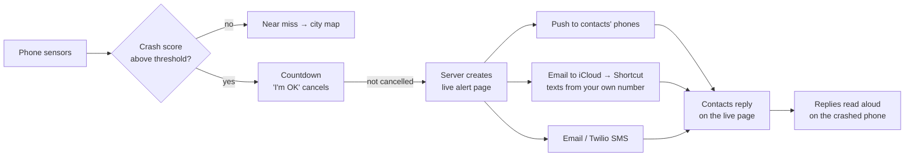

<div align="center">

# 🚨 Crashline

### Crash safety for the people car safety tech forgets.

Crash and near-miss detection for **drivers, cyclists, scooter riders, wheelchair users, and pedestrians**: automatic emergency alerts, a language bridge for the scene, and an anonymous city map of near misses.

**HackGT 2027 · Social Good track (presented by Cox Automotive)**


**[▶ Try it live](https://45-76-248-250.sslip.io)** · [The problem](#the-problem) · [Features](#features) · [How it works](#how-it-works) · [Quick start](#quick-start) · [Configuration](#configuration) · [Deploy](#deploy) · [Demo script](docs/DEMO.md)

</div>

---

## The problem

Crash detection exists, but it's built for one person: an English-speaking driver in a newer car with a flagship phone.

- 🚲 **People on bikes, scooters, and wheelchairs, and people walking** are the most likely to be badly hurt when a car hits them, yet they get no crash detection and no guidance built for them.
- 🗣️ **People who don't speak English** are alone at the scene, can't explain what happened to police, and are often blamed because of it.
- 🗺️ **Neighborhoods** get a dangerous intersection fixed only after someone dies there, because near misses are never recorded.

## Features

### 📱 Detection for every way people travel
Pick **Car, Bike, Scooter, Wheelchair, or Walking**. Each mode has its own thresholds and scoring.

| | What triggers it | What happens |
|---|---|---|
| **Crash** | A big impact plus supporting evidence (stopped, tipped over, loud bang, no free fall) | Countdown with a big **I'm OK** button, then contacts are alerted automatically |
| **Near miss** | Sustained hard braking or swerving below crash level, or a GPS hard brake | Logged anonymously to the city map |
| **Close call** | One tap when a car passes too close | Logged to the map. Sensors can't feel it, but riders can |

After a crash, the questions and next steps adapt to the mode. On a bike it asks about head hits and whether the driver left, and walks you through a hit-and-run report.

### 🆘 Automatic alerts that don't need you conscious
If the countdown runs out, Crashline alerts your people through every channel that's set up, with no tap needed:

- **Urgent push notification**, e.g. `🚨 Maria may have crashed · Biking · 4:17 PM · 📍 Near Peachtree St NE · ⚕️ medical notes`, with an SOS vibration and an **I'm on my way** button. It stays on screen until handled.
- **Live alert page**: a live map that follows the phone for up to an hour, medical notes, **Call them** / **Call 911**, and reply buttons (*seen*, *on my way*, *called 911*, *reached them*). Replies are read aloud on the crashed phone.
- **Real texts from your own iPhone number** through a shared Shortcut (free, no texting service; [details](#texts-from-your-own-iphone)).
- **Email** and **Twilio SMS** when configured.
- **No response in 2 minutes?** Everyone gets a second alert: *⚠️ No one has responded*.

### 🗣️ Language bridge
- **Face-to-face translator:** the top half of the screen flips to face the officer, and each side sees and hears the other in their own language.
- **Offline phrase cards** in Spanish, Chinese, Vietnamese, Korean, Arabic, Haitian Creole, Portuguese, French, and Hindi (*"I need an interpreter," "I am hurt," "A car hit me"*), shown and spoken in English.
- **Know-your-rights card** in your language. AI guidance comes back in your language, and alerts tell contacts you may need an interpreter.

### 🗺️ City safety map (`/map.html`)
Every near miss, close call, and crash is shared anonymously: location rounded to about 50 m, hour-level time, no name or ID. The map ranks dangerous spots, filters by who's at risk, updates live, and exports a **CSV** a city transportation department can use.

### 🧰 More
- **Black box:** the last minute of motion and GPS before a crash (plus optional dashcam video) is kept on the phone with a SHA-256 fingerprint. The server timestamps the fingerprint, never the video.
- **Auto-start:** starts a trip when you start moving and guesses walk, bike, or drive from speed.
- **People on Crashline:** find contacts who already use the app and add them as emergency contacts with one request.
- **Accounts:** email and password out of the box, plus Google and Apple through Auth0. Your profile and contacts sync across devices.
- **Contact import:** the phone's contact picker (Android, or iPhone with a Safari flag) or a `.vcf` card.
- **Car:** experimental OBD-II speed over Web Bluetooth.
- **Installable PWA** that works offline after first load, with a dashboard layout on desktop.
- **Delete my profile** removes everything on the device and the server.

## How it works

### Crash detection
Instead of a single g-force threshold, every jolt above the trigger becomes a **candidate** that's scored over the next 3 seconds:

| Signal | Points toward a crash | Points away |
|---|---|---|
| Impact | High peak sustained 50–150 ms, large velocity change | A single-sample spike |
| Free fall | | Weightless just before the hit (a dropped phone) |
| Rotation and tilt | Tumbling, ending on its side | |
| Speed (GPS / OBD-II) | Moving, then suddenly stopped | Kept moving |
| Aftermath | Still afterward (and GPS agrees) | Picked up, walking again |
| Sound | A loud bang at the same moment | |

Weights differ for drivers, riders, and pedestrians. Severe sustained impacts always alarm. **Sensitivity** (Fewer alarms / Balanced / More sensitive) sets the confidence needed: 72% / 62% / 52%.

The in-app **Detection Lab** replays 11 recorded situations through the real engine: crashes and look-alikes such as potholes, curb bumps, phones dropped while parked, driving, or walking, and being rear-ended at a light. `npm test` runs the same scenarios at all three sensitivities.

### Alert flow



### Texts from your own iPhone
iPhones don't let any app send texts silently, but Shortcuts can. Every phone has a random token. When an alert fires, the server saves the recipients and message under that token and emails the user's iCloud address with the subject `CRASHLINE SOS <token>`. A shared **Crashline SOS** Shortcut, run by an Email automation, reads the token, fetches `GET /s/<token>` (`{ "to": [...], "text": "..." }`), and texts each contact. Contacts are managed in the app, so nobody edits the Shortcut.

**One-time team setup:** build the Shortcut using the steps in Settings → *Auto-text from my iPhone*, share it with **Copy iCloud Link**, and set `SHORTCUT_URL`.<br/>
**Each user (about a minute):** enter their iCloud email → **Add Shortcut** → create an Email automation (Sender = your SMTP address, Subject contains `CRASHLINE SOS`, Run Immediately) → **Send test**.

## Tech stack

| Layer | What |
|---|---|
| Frontend | Vanilla JS ES modules, no build step. Installable PWA with a service worker |
| Sensors | DeviceMotion, Geolocation, Web Audio, MediaRecorder, Web Bluetooth (OBD-II), Wake Lock |
| Maps | Leaflet, OpenStreetMap tiles, Nominatim reverse geocoding |
| Backend | Node.js + Express, JSON file storage |
| Alerts | Web Push (VAPID), Nodemailer (SMTP), Twilio, iOS Shortcuts |
| Auth | scrypt email/password sessions, Auth0 (Google and Apple) verified with `jose` |
| AI | Google Gemini or Anthropic Claude, for translation and tailored guidance |
| Hosting | Vultr + Caddy (automatic HTTPS), or Render |

## Quick start

Clone this repo (green **Code** button above → copy the URL), then:

```bash
git clone <repo-url> crashline
cd crashline
npm install
npm start
```

- Live: <https://45-76-248-250.sslip.io>
- App: <http://localhost:3000>
- City map: <http://localhost:3000/map.html>

Everything works without API keys: detection, the countdown, push alerts, the live alert page, phrase cards, the built-in guide, and the map. The map starts with clearly labeled **sample data** around Georgia Tech and Midtown, which you can toggle off. To reset, stop the server and delete `data/`.

**On a phone without deploying:** sensors need HTTPS, so run `npx localtunnel --port 3000` and open the link it prints.

**Tests:**
```bash
npm test
```

## Configuration

Copy `.env.example` to `.env`. **Every key is optional.** Each one turns on a feature.

| Variable | Turns on |
|---|---|
| `GEMINI_API_KEY` *or* `ANTHROPIC_API_KEY` | Live translation, translated rights card, AI steps in the user's language. `AI_PROVIDER`, `GEMINI_MODEL`, and `ANTHROPIC_MODEL` are optional overrides |
| `AUTH0_DOMAIN`, `AUTH0_CLIENT_ID` | Google sign-in. Add `AUTH0_APPLE=true` once Apple is set up in Auth0 |
| `SMTP_USER`, `SMTP_PASS` | Email alerts and the iPhone auto-text trigger (Gmail App password). `SMTP_HOST`, `SMTP_PORT`, and `SMTP_FROM` are optional |
| `SHORTCUT_URL` | iCloud link to the shared Shortcut, which shows the **Add Shortcut** button |
| `TWILIO_ACCOUNT_SID`, `TWILIO_AUTH_TOKEN`, `TWILIO_FROM` | Automatic SMS from a Twilio number. US carriers need a verified toll-free number, and trials can't send custom text |
| `NO_RESPONSE_MS` | Delay before the "no one has responded" re-alert (default `120000`) |
| `PORT` | Server port (default `3000`) |

VAPID keys for push are generated on first run and saved to `data/vapid.json`.

<details>
<summary><b>Setting up Google and Apple sign-in (Auth0)</b></summary>

1. auth0.com → **Applications → Create Application → Single Page Application**.
2. Under **Settings**, add your site to **Allowed Callback URLs** and **Allowed Logout URLs**, both with and without the trailing slash (`https://your-site, https://your-site/, http://localhost:3000, http://localhost:3000/`). Add it to **Allowed Web Origins** without slashes.
3. **Authentication → Social:** Google works right away with Auth0's dev keys. For Apple, create the connection with the key fields blank (test keys), then enable it for the app. Production Apple sign-in needs an Apple Developer account.
4. Set `AUTH0_DOMAIN`, `AUTH0_CLIENT_ID`, and optionally `AUTH0_APPLE=true`, then restart.

If sign-in fails, the app shows which Auth0 setting is missing.
</details>

## Deploy

### Vultr (one command)
Create an Ubuntu 24.04 server, then from the project folder:

```bash
bash deploy/push.sh YOUR_SERVER_IP                 # → https://YOUR-IP.sslip.io
bash deploy/push.sh YOUR_SERVER_IP yourdomain.xyz  # with your own domain (A record → IP)
```

This installs Node 20, a systemd service, and Caddy with automatic HTTPS. Run it again to ship updates. Your `.env` is uploaded, but it never goes into git. Logs: `ssh root@IP journalctl -u crashline -f`.

### Render
**New → Blueprint** → pick this repo. Render reads `render.yaml`. The free tier sleeps after 15 idle minutes.

### Install on a phone
- **iPhone (Safari):** Share → **Add to Home Screen**
- **Android (Chrome):** **Install** on the in-app card, or menu → **Install app**

## Privacy

- Map reports are snapped to a ~50 m grid with hour-level time and no identifiers. Sharing can be turned off.
- Black-box recordings never leave the phone. Only a fingerprint is timestamped.
- Live alert links are unguessable, contacts can view but not edit, and the links expire after 48 hours.
- Passwords are hashed with scrypt, and session tokens are stored hashed.
- AI, alert, and texting routes are rate-limited per visitor.

## Limits and roadmap

A website can't run detection with the app fully closed, read Apple Health or Health Connect, or appear on CarPlay or Android Auto. Those are the reasons for a native app. Next steps: native background detection, a verified SMS sender so texting needs no setup, Android auto-texting, and city partnerships for the near-miss data.

## Project structure

```
server.js              API: alerts, incidents, accounts, people, map events, AI
lib/
  alerts.js            Push, email, SMS, iPhone auto-text jobs
  incidents.js         Live alert pages (48 h TTL)
  accounts.js          Email/password + Auth0 sessions
  people.js            Find contacts on Crashline, contact requests
  geo.js               Reverse geocoding
  seed.js              Labeled sample data for the map
public/
  index.html, app.js   App screens, trips, crash flow
  detector.js          Crash and near-miss detection engine
  scenarios.js         Recorded situations for the Detection Lab and tests
  settings.js          Settings, alerts, auto-text, permissions
  talk.js, i18n.js     Language bridge and phrase cards
  alert.html/.js       Live alert page contacts open
  map.html/.js         City safety map
  sw.js                Offline cache and push notifications
deploy/                Vultr deploy scripts (Caddy + systemd)
tests/                 Detection tests (npm test)
docs/DEMO.md           Demo script, judge Q&A, team split
```

---

<sub>Crashline gives general safety information. It is not a substitute for emergency services or legal advice. In an emergency, call 911.</sub>
